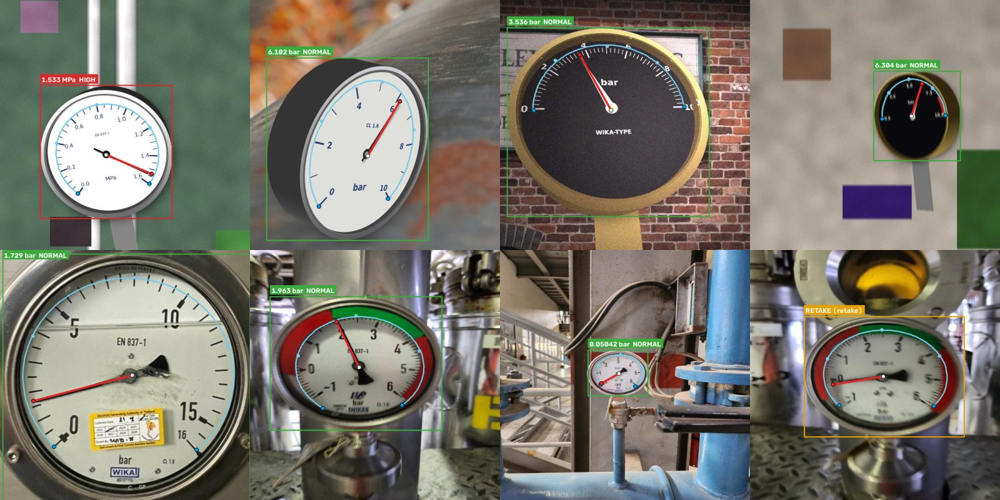
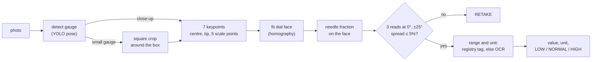

# mv2npp-gauge-reading

**Reading analog gauges in nuclear power plants from a single photo, trained only on synthetic data.**

Operators in older nuclear units still walk rounds and log hundreds of analog pressure,
temperature and differential-pressure gauges by eye. This project reads a gauge from one photo
(taken by a patrol robot, a drone or an operator's phone), returns the value with its unit,
flags LOW / HIGH against the instrument's alarm band, and asks for a new photo (RETAKE) when it
is not sure. The model never sees a real photo in training: it learns from our own synthetic
gauge generator and is tested on public real photos.

**Try it:** [browser demo](https://huggingface.co/spaces/uhyon/mv2npp-gauge-reader) (runs on
your CPU, the photo is not uploaded) · **Model:**
[uhyon/mv2npp-gauge-pose](https://huggingface.co/uhyon/mv2npp-gauge-pose) (`best.onnx`, `best.pt`)



*Version 5b, range from the gauge registry. Top: our synthetic renders (clean, 50° tilt, low
light, motion blur). Bottom: real photos from the Roboflow "Analog Gauge Reading" set (CC BY 4.0,
[sources](demo/examples/ATTRIBUTION.md)). Blue: fitted scale arc and scale points; red: needle.
The dim photo on the right comes back as RETAKE: its three rotated reads differ by 5.7% of the
scale.*

## Results

Real photos only, none used in training. Errors are in % of full scale (FS). "Read" counts the
photos the reader accepts; "all" counts every RETAKE as a miss. Full tables:
[docs/RESULTS.md](docs/RESULTS.md). Status per requirement:
[docs/STAGE3_REVIEW.md](docs/STAGE3_REVIEW.md).

| Requirement | Target | Result | |
| --- | --- | --- | :-: |
| Reading error, MeterFL (262 pressure-gauge photos), range given | mean ≤ 2% FS | **1.36% FS** (median 0.78) | ✅ |
| Share within 2% FS, MeterFL | ≥ 85% | **86% of read photos**; 76% of all (12% RETAKE) | 🟡 |
| Gauge detection, Roboflow obaw9 (1,471 photos) | AP50 ≥ 0.90 | 0.955 | ✅ |
| CPU time per photo, ONNX Runtime, Intel i5-12400 | ≤ 0.5 s | 0.29 s registered gauge · 0.54 s with OCR · 0.10 s fast mode | 🟡 |
| Robustness: low light, radiation speckle, motion blur added to MeterFL | report | mean 1.2–2.0% FS at every level; strong blur → 45% RETAKE | ✅ |

The 85% target is met on the photos the reader accepts but not on all photos. We report both
instead of moving the target. Most of the gap comes from 9 MeterFL dials turned by 90° or more
(our renders roll at most ±30°, so the reader sends them to RETAKE) and from label noise of up
to 1% FS in MeterFL (3 of 30 hand-checked labels).

How the model got here (MeterFL, range given, integrated reader where noted):

| Version | Change | Mean % FS | ≤ 2% FS |
| --- | --- | ---: | ---: |
| 1 | baseline: 4 keypoints, angles in the image | 2.93 | 68% |
| 2 | full-circle rotation in training | 10.18 | 33% (dropped) |
| 3 | 3 extra scale-arc keypoints, needle read on the fitted dial face | 2.83 | 74% |
| 3 + reader | crop small gauges, three rotated reads, RETAKE above 5% spread | 1.79 (read) | 81% read / 73% all |
| 4 | yolo11m instead of yolo11s | ≈ v3, 3× slower | (dropped) |
| **5b + reader** | synthetic data with small gauges and dual-scale dials | **1.36 (read)** | **86% read / 76% all** |

On our synthetic val split the dial-face fit removes almost all of the tilt error (Version 3:
0.66% FS, 96% within 2%; 0.79% FS at 40°+ tilt, against 3.37% for Version 1).

## How it works



1. **Synthetic data** ([docs/SYNTHETIC.md](docs/SYNTHETIC.md)). A procedural generator draws
   20,000 dials with random design, range, unit and needle value, puts them in a 3D case on a
   background photo, and adds NPP field conditions: low light, glass glare, motion and defocus
   blur, radiation speckle noise and dirt. Every render comes with its box, keypoints, range and
   true value, so there is no hand labelling.
2. **One network for detection and keypoints.** A YOLO11s pose model finds the gauge and seven
   points: needle centre, needle tip, scale start and end, and three points on the scale arc.
   Trained for 50 epochs on a free Kaggle T4 ([docs/TRAINING.md](docs/TRAINING.md)).
3. **Reading on the dial face.** The centre and the five scale points are the image of a circle
   and its centre, so a homography back to a flat, round dial can be fitted. The needle is read
   on that face, where a tilted camera no longer bends the angles.
4. **Knowing when not to answer.** The crop is read three times (upright and turned ±25°). If
   the three values differ by more than 5% of the scale, or the scale arc looks implausible,
   the answer is RETAKE instead of a guess.
5. **Range and alarm.** For a known instrument the range, unit and alarm band come from a gauge
   registry ([configs/gauges.csv](configs/gauges.csv), tags made up for the demo), and OCR of the
   dial numbers only checks that the right gauge was photographed. For an unknown gauge OCR
   reads the range.

## Limitations

- **No photos of real nuclear plant gauges.** None are public, and we could not photograph any.
  NPP conditions are approximated by synthetic degradation of public photos.
- **Evaluation sets are small and narrow.** MeterFL is 262 photos, 123 of them frames of the same
  gauge; MeasureBench has only 42 dial photos with a labelled range.
- **Dials turned by 90° or more** are not read (RETAKE). Training rotation is limited to ±30°
  because full-circle rotation made the model lose the dial's orientation (Version 2).
- **OCR needs a sharp photo.** Under motion blur or low light the range must come from the
  registry; with OCR the full pipeline also misses the 0.5 s target (0.54 s).
- **Dual-scale, tyre and wide-arc (> 270°) gauges** are weak points (see MeasureBench in
  [docs/RESULTS.md](docs/RESULTS.md)).
- Version 5b has not yet been re-run on MeasureBench and the synthetic val split; those rows in
  RESULTS.md are Version 3.

## Data

Training uses only our own renders. Evaluation uses public real photos; none of them are
redistributed here except the four CC BY 4.0 Roboflow demo photos.

| Set | Use | License |
| --- | --- | --- |
| Own synthetic renders (`configs/synth_2d_v5b.yaml`) | training, synthetic val | generator MIT; the 263 background photos (Openverse: CC BY, CC0, public domain) are credited in `assets/backgrounds/ATTRIBUTION.csv` and not redistributed |
| [MeterFL](https://github.com/weidazhaoooo/Meter-FL) (2026) | main reading error: 262 pressure-gauge crops, 30 labels checked by hand | CC BY-SA 4.0; not in demos |
| MeasureBench real_world, dial subset (Lin et al., CVPR 2026) | secondary: interval hit rate | CC BY-SA 4.0; not in demos |
| Roboflow Analog Gauge Reading (v4tii) | keypoint accuracy, demo photos | CC BY 4.0 |
| Roboflow analog-gauge (obaw9) | detection | CC BY 4.0 |

Download scripts and preprocessing: [docs/DATASETS.md](docs/DATASETS.md).

## Quick start

Python ≥ 3.10, CPU only. With [uv](https://docs.astral.sh/uv/):

```bash
git clone https://github.com/uhyon/mv2npp-gauge-reading && cd mv2npp-gauge-reading
uv venv && uv pip install -e ".[ocr,dev]" ultralytics onnxruntime huggingface_hub
uv run pytest

# get the Version 5b weights from the model repo
uv run python -c "from huggingface_hub import hf_hub_download as d; print(d('uhyon/mv2npp-gauge-pose', 'best.onnx', local_dir='weights'))"

# read a photo of a registered gauge (range, unit and alarm band from the registry)
uv run python scripts/read_gauge.py --weights weights/best.onnx \
    --registry configs/gauges.csv --tag PI-101 demo/examples/PI-101__synth_clean.jpg

# unknown gauge: the range comes from OCR
uv run python scripts/read_gauge.py --weights weights/best.onnx photo.jpg

# local Gradio demo (pip install -e ".[demo]")
GAUGE_WEIGHTS=weights/best.onnx uv run python demo/app.py
```

`read_gauge.py` prints one JSON line per photo: value, unit, status, alarm, the rotation spread
and the time per stage. Generating data, training on Kaggle and the evaluation scripts are in
[docs/TRAINING.md](docs/TRAINING.md).

## Repository

```
configs/            generator configs, gauge registry (gauges.csv)
demo/               Gradio app (app.py), browser demo (web/), example photos
docs/               proposal, requirements, datasets, results, training notes
notebooks/          Kaggle training notebook
scripts/            data download, generation, training, reading, evaluation
src/gauge_reader/
  synth/            synthetic gauge generator (dial, 3D case, scene, degradations)
  keypoints/        YOLO pose wrapper
  reading/          geometry (value, alarm), dial-face fit, scale OCR
  eval/             dataset loaders, metrics, degradations for robustness tests
  reader.py         GaugeReader: the whole pipeline on one photo
tests/              pytest (200+ tests)
```

Project documents: [proposal](docs/PROPOSAL.md) · [requirements](docs/REQUIREMENTS.md) ·
[datasets](docs/DATASETS.md) · [related work](docs/RELATED_WORK.md) ·
[synthetic data](docs/SYNTHETIC.md) · [training](docs/TRAINING.md) · [results](docs/RESULTS.md) ·
[stage 3 review](docs/STAGE3_REVIEW.md)

## Related work

Howells et al. (CVPRW 2021), León-Alcázar et al. (WACV 2024), Reitsma et al. (ICRA 2024),
MeasureBench (Lin et al., CVPR 2026) and KAERI's gauge-reading work for nuclear facilities
(KNS 2025, ICCAS 2025). Details in [docs/RELATED_WORK.md](docs/RELATED_WORK.md).

## License

Code: MIT. Datasets keep their own licenses (docs/DATASETS.md); demo photos
from Roboflow are CC BY 4.0 ([attribution](demo/examples/ATTRIBUTION.md)).
