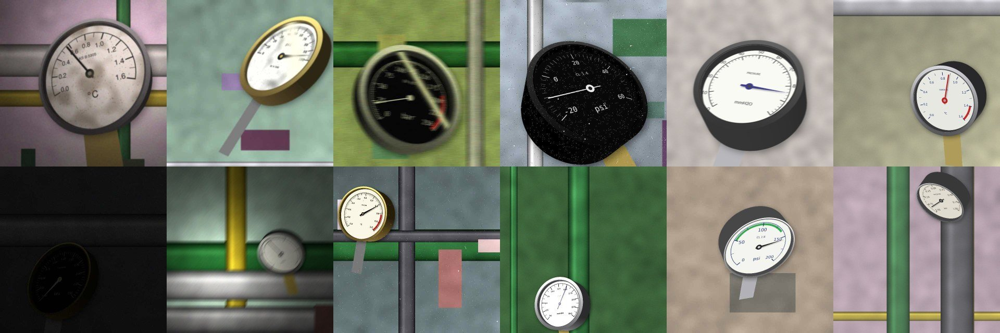

# mv2npp-gauge-reading

**Reading analog gauges in nuclear power plants from a single photo, trained on synthetic data.**

Operators in older nuclear units still walk rounds and log hundreds of analog pressure,
temperature and differential-pressure gauges by eye. This project builds an end-to-end pipeline
that reads a gauge from a photo, flags out-of-range values, and asks for a retake when unsure,
for patrol robots, drones or a phone in an operator's hand.

> Status: phase 3 (baseline training and first evaluation), 2026-11-13. Target: portfolio-ready demo by 2026-11-26.

## Pipeline

```
photo -> 1. gauge detection (YOLO)
      -> 2. face rectification (homography)
      -> 3. keypoints: needle center/tip, scale min/max (heatmaps)
      -> 4. scale OCR: range and unit
      -> 5. value = angle -> scale, alarm (LOW / HIGH / NORMAL / RETAKE)
```

Training data comes from our own synthetic generator that randomizes dial design, camera pose and
NPP field conditions (low light, glass glare, motion blur, radiation speckle noise, dirt).
Evaluation uses public real images only: MeterFL for reading error, MeasureBench for interval hit rate,
and Roboflow sets for keypoints and detection, plus a robustness test that adds low light, radiation
speckle noise and motion blur to those images. See [docs/DATASETS.md](docs/DATASETS.md).



Synthetic generator: [docs/SYNTHETIC.md](docs/SYNTHETIC.md). Training and evaluation: [docs/TRAINING.md](docs/TRAINING.md).

**Limitation:** no photos of actual nuclear power plant gauges are in the evaluation. NPP field
conditions are approximated by synthetic degradation.

## Targets

| Metric | Target |
| --- | --- |
| Gauge detection mAP@0.5 | >= 0.90 |
| Reading error (% of full scale) | <= 2% |
| Share of readings within 2% | >= 85% |
| CPU latency per image | <= 0.5 s |

## Layout

```
configs/            generator and training configs
data/               raw, synthetic, processed (git-ignored)
docs/               datasets, related work, experiment notes
scripts/            download_data.py and other entry points
src/gauge_reader/
  synth/            synthetic gauge generator (dial.py, scene.py)
  detection/        stage 1
  keypoints/        stage 3
  reading/          stage 5: geometry.py (angle -> value, alarm)
tests/
demo/               Gradio app (Hugging Face Spaces)
```

## Quick start

```bash
pip install -e ".[dev]"
pytest
python scripts/download_data.py --help
python scripts/generate_synth.py --num 24 --preview preview.jpg
```

## Related work

Howells et al. (CVPRW 2021), León-Alcázar et al. (WACV 2024), Reitsma et al. (ICRA 2024),
and KAERI's gauge-reading work for nuclear facilities (KNS 2025, ICCAS 2025). Details in
[docs/RELATED_WORK.md](docs/RELATED_WORK.md).

## License

Code: MIT. Datasets keep their own licenses (see docs/DATASETS.md).
