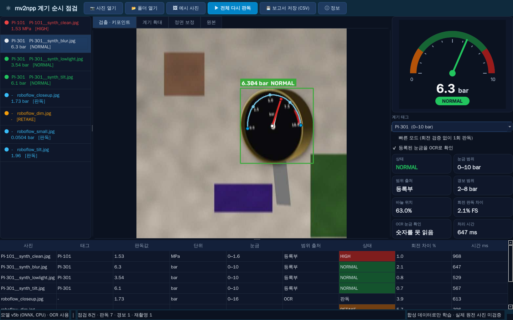

# Desktop app (round check)

A window for a whole round of gauge photos: open photos or a folder (or drop them on the
window), every gauge is read in the background, and the results go into a table that can be
saved as a CSV report.



*Version 5b model on the demo examples. PI-301 is a synthetic render; the Roboflow photos
in the list are CC BY 4.0 ([credits](../demo/examples/ATTRIBUTION.md)).*

- **Left:** the photos, coloured by result (green NORMAL, red HIGH, amber LOW or RETAKE, blue read
  without an alarm band).
- **Centre:** detection and keypoints, the gauge close-up, the dial seen from the front, the original.
- **Right:** the reading on a meter with the alarm band, the gauge tag, and the details: scale
  range and where it came from (registry or OCR), alarm band, needle position, spread of the
  three rotated reads, OCR check of a registered range, time.
- **Bottom:** one row per photo; **보고서 저장 (CSV)** saves it.

A photo named `TAG__anything.jpg` (for example `PI-301__round1.jpg`) uses the registered gauge
`TAG` from [configs/gauges.csv](../configs/gauges.csv); any other photo reads its range from the dial
numbers with OCR. The tag of the selected photo can be changed on the right.

## Windows: no Python needed

Download `mv2npp-gauge-reader-windows.zip` from the
[latest release](https://github.com/uhyon/mv2npp-gauge-reading/releases/latest), unzip it and run
`mv2npp-gauge-reader.exe`. The build is not code-signed, so Windows SmartScreen may warn on the
first start: choose "More info" → "Run anyway".

The zip is built by [.github/workflows/desktop-windows.yml](../.github/workflows/desktop-windows.yml)
on a Windows runner: PyInstaller with [mv2npp.spec](mv2npp.spec), the version 5b ONNX model
from [uhyon/mv2npp-gauge-pose](https://huggingface.co/uhyon/mv2npp-gauge-pose) (checked by SHA-256),
headless OpenCV, ONNX Runtime and RapidOCR, but no PyTorch. The workflow then runs the exe with
`--selftest` (it reads the example photos without a window). Pushing a tag `desktop-v*` attaches the
zip to a GitHub release; every run also keeps it as a workflow artifact for 14 days.

## From source (Windows, macOS, Linux, WSL)

```bash
uv pip install -e ".[desktop,ocr]"
uv run python desktop/app.py                    # weights/best.onnx, or set GAUGE_WEIGHTS
uv run python desktop/app.py path/to/photos     # open a folder at start
uv run python desktop/app.py --selftest         # read the examples without a window
```

The app runs the model on ONNX Runtime alone
([onnx_pose.py](../src/gauge_reader/keypoints/onnx_pose.py)); on the demo examples it gives the
same readings as Ultralytics. Under WSL the window needs WSLg (Windows 11).
