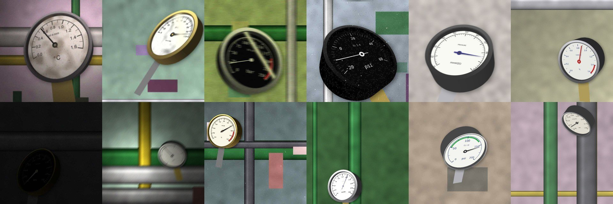

# Synthetic gauge generator (2D)

`scripts/generate_synth.py` renders labelled training images from `configs/synth_2d.yaml`.
Code: `src/gauge_reader/synth/dial.py` (flat dial) and `src/gauge_reader/synth/scene.py`
(camera, background, field conditions).



```bash
python scripts/generate_synth.py --num 24 --preview preview.jpg          # contact sheet with labels drawn
python scripts/generate_synth.py --out data/synthetic/synth_2d           # full set (20,000 by default)
```

About 13 images/s on 4 CPU cores (640 px), so 20,000 images take about 25-30 minutes.
Image `i` uses seed `seed + i`, so any single image can be regenerated.

## What is randomized

| Part | Randomized |
| --- | --- |
| Scale | 20 ranges (0-1 to 0-400, vacuum and compound ranges, -20-60), 7 units, sweep 180-270 deg, 4-10 major intervals with "nice" steps, 2/4/5/10 minor divisions |
| Dial design | face/ink palette (incl. black face), font (from `assets/fonts` or system fonts), tick length/width, labels inside or outside the ticks, red/green zones, brand text, inner second scale (bar/psi) |
| Needle | taper, line or arrow; length, tail, hub size, colour; soft shadow |
| Case | bezel width and colour (steel, black, brass), 3D side wall (depth 0.15-0.5 x diameter), face recessed 0.02-0.08 x diameter behind the glass (parallax against the bezel), contact shadow, stem/process connection |
| Camera | yaw ±50, pitch ±40, roll ±15 deg, focal 0.8-2.5 x image size, gauge diameter 0.25-0.9 x image size; the case always stays inside the frame |
| Background | photos from `assets/backgrounds` (70%) or procedural walls, pipes, panels and grime |
| NPP conditions | low light (dim + torch spot + amplified shot/read noise), glass glare (spot or window band), motion blur, defocus, radiation speckle (hot pixels, blobs, short streaks), dirt on the glass, JPEG 35-95 |

The gauge is a short cylinder: bezel and glass at the front, the printed face recessed behind them,
the case wall going back. Each layer is warped with the homography of its own plane, so at oblique
views the wall shows and the face shifts against the bezel. Glare and dirt are drawn on the glass
plane. Keypoints and `homography` refer to the face plane.
The applied conditions are recorded per image, so results can be split by condition.

## Labels

Keypoints follow `gauge_reader.reading.geometry`: `center`, `tip` (needle tip), `scale_min` and
`scale_max` (outer ends of the first and last major ticks). The scale runs clockwise from min to max.

- `labels/{train,val}/*.txt`: YOLO pose, `0 cx cy w h` + 4 x `(x y v)`, normalized. `data.yaml`
  has `kpt_shape: [4, 3]`. Train with `fliplr=0`: a mirrored dial reads counter-clockwise.
- `labels.jsonl`: value, range, unit, sweep, steps, image and flat-dial keypoints, bounding box,
  the 3x3 dial-to-image homography (target for the rectification stage), conditions, camera pose, style,
  and `background` (file name of the background photo, `null` for procedural). For a set generated
  before this field existed, `generate_synth.py --backfill-backgrounds --out <set>` adds it by
  replaying each seed (same config and background folder needed; no images are written).

`tests/test_synth.py` checks that mapping the image keypoints back through the homography and
reading them with `read_value` gives the true value exactly.

## Known gaps (next)

- Non-linear scales (e.g. square-root flow dials) and multi-turn dials are not generated.
- Unit and range are paired at random, so some pairs are unrealistic (e.g. -20-60 MPa).

## Background photos

`scripts/download_backgrounds.py` fetches CC0, public-domain and CC BY photos of pipes, valves,
pump rooms and turbine halls from [Openverse](https://openverse.org) into `assets/backgrounds/`,
with a credit line per photo in `assets/backgrounds/ATTRIBUTION.csv`. Photos are not committed;
the CSV is: `download_backgrounds.py --from-csv` fetches exactly the listed photos under the same
names, which reproduces the reviewed set (and the generated images), and it doubles as
the credit list. README and demo images use only CC0, public-domain or procedural backgrounds,
so they need no per-image credit.

```bash
uv run python scripts/download_backgrounds.py            # about 300 photos, 15 per search term
uv run python scripts/download_backgrounds.py --sheet    # rebuild review sheets after deleting
```

Review `assets/backgrounds_review/review_*.jpg` and delete photos that show a round dial gauge:
an unlabelled gauge in the background teaches the detector to ignore real gauges.
Then scan for gauges the eye missed (`scripts/scan_backgrounds.py`, COCO "clock" detector and,
once trained, the gauge model). Done for the current set on 2026-11-13: 287 photos downloaded,
24 deleted by eye, the COCO scan flagged 13 regions in the remaining 263 and none was a gauge
(e.g. relay setting knobs, a wristwatch, part of a transformer), so 263 photos remain.
Credit CC BY photos (creator, licence, link from the CSV) wherever a synthetic image is shown.
